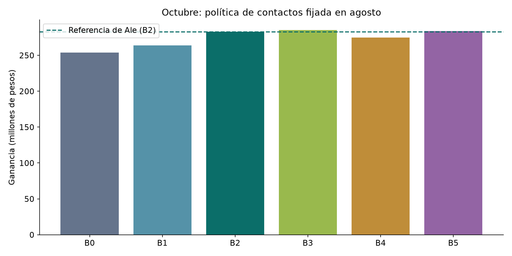

# Variables históricas: experimento acumulativo B0–B5

**Ejecutado el 7 de noviembre de 2026 en `clari-c1-fundados`.** Se completaron 120 evaluaciones de hiperparámetros, se congelaron seis modelos y sus políticas de contactos, y se evaluó octubre de 2019. Las ganancias se verificaron de forma independiente.

Este experimento es distinto de `HISTORIA_2019_01`: aquí B0 usa sólo originales, B2 es la referencia de Ale y el AUC de validación usa BAJA+1 y BAJA+2 combinadas. No comparar los nombres B0 entre carpetas como si fueran el mismo modelo.

## Resultados

| Modelo | Familia incorporada | AUC agosto | Ganancia octubre | Contactos |
|---|---|---:|---:|---:|
| B0 | Originales | 0,924121 | $254.017.500 | 4.923 |
| B1 | Lags 1 y 2 | 0,930033 | $264.055.000 | 4.798 |
| B2 | Deltas 1 y 2; referencia de Ale | 0,933028 | $282.645.000 | 5.042 |
| B3 | Medias de tres meses | 0,931596 | $285.147.500 | 4.711 |
| B4 | Pendientes de tres meses | 0,932238 | $274.615.000 | 3.094 |
| B5 | Ratios 1 y 2 | 0,932468 | $283.882.500 | 3.597 |

B3 obtuvo la mayor ganancia observada con las políticas fijadas en agosto: **$2.502.500 más que B2 (0,89 %)**. Al igualar los contactos, B2 y B3 empatan y B4 queda primero por un acierto adicional. Una semilla y un mes de test no demuestran estabilidad general ni significancia estadística.



## Materiales

- [Conclusiones y explicación de la política de contactos](conclusiones.txt).
- [Informe completo](informe.html): descargar y abrir en el navegador; GitHub muestra su código HTML.
- [Resultados numéricos](resultados/resultados.csv) y [políticas de contactos](resultados/politicas_contactos.csv).
- [Guion del video grupal](guion_video.txt) y [bibliografía](bibliografia.txt).
- [Análisis del material de Marcelo](analisis_del_material.txt) y [tabla de usos/exclusiones](marcelo_usar_adaptar_excluir.csv).
- [Configuración congelada](config.json), [código](src), [versiones](requirements_vm.txt) y [auditoría](auditoria).

## Reproducir desde cero

Con Python **3.12.3**, el Parquet original y conexión para instalar las versiones fijadas, desde esta carpeta:

```bash
python3 reproducir.py --data '/ruta/competencia_02_crudo.parquet' --out '/ruta/nueva_corrida' --python python3.12
```

La carpeta de destino debe ser nueva. El programa verifica integridad, crea el entorno, construye variables, entrena B0–B5, congela decisiones, evalúa y compara resultados. Ver [instrucciones completas](REPRODUCIR.txt).

La base se identifica por SHA-256 `84dffddadf9216be9460793ea3c28d87bff82b3c194a67a2e49fc7b4a7475a22`. No se acepta silenciosamente otra base.

## Datos fuera de GitHub

Este repositorio incluye modelos finales y resultados agregados, **no el Parquet ni predicciones con identificadores de clientes**. Las copias completas permanecen en la computadora y en la carpeta original de la VM. Las predicciones de referencia se regeneran localmente desde los modelos congelados, después de verificar que las matrices coincidan con las huellas originales. Así se puede comprobar la reproducción sin publicar datos individuales.

El historial original del experimento se conserva en el repositorio local y su bundle; no se importó a GitHub porque contiene esas predicciones. La procedencia del código y las huellas están documentadas en `auditoria/`.
